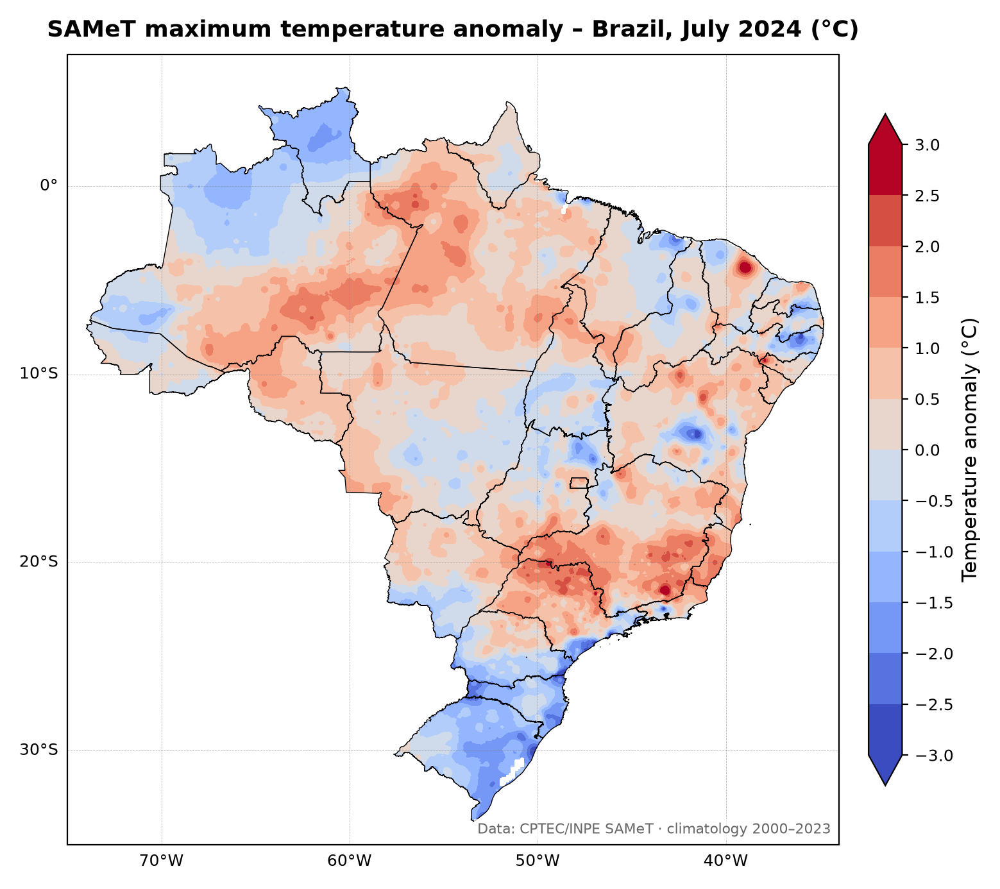
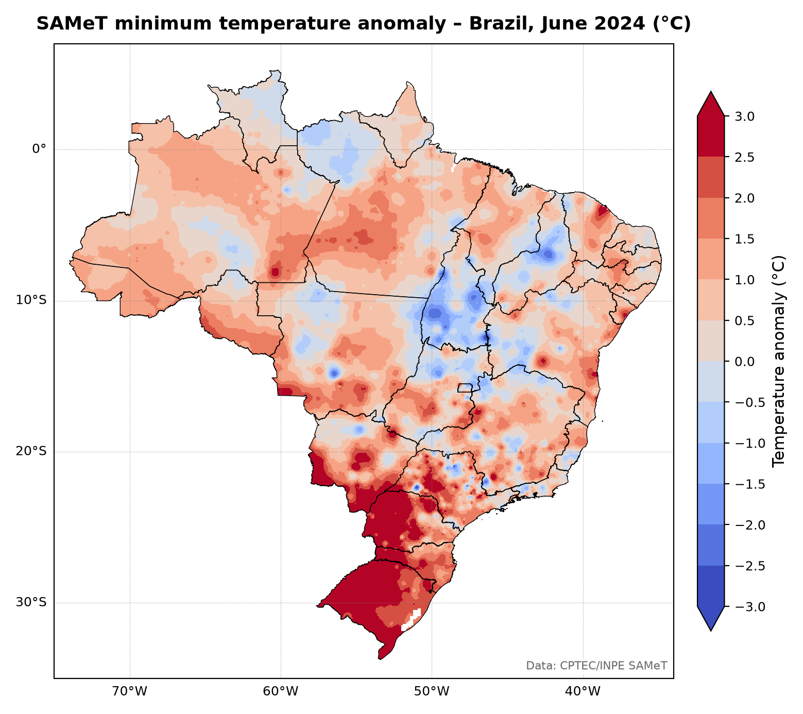
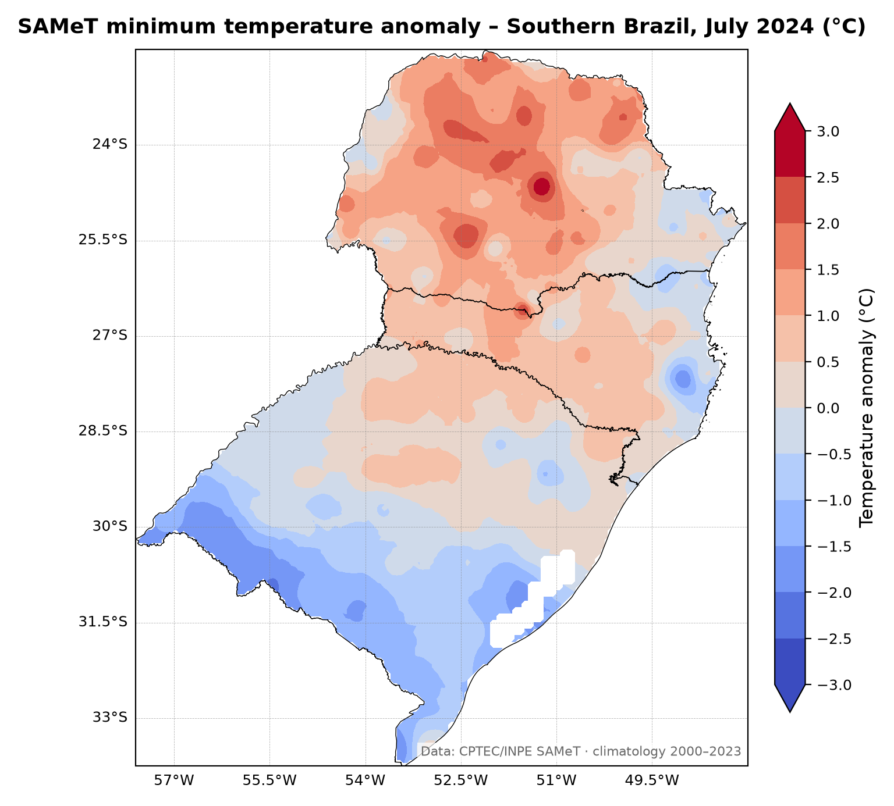

# Temperature Anomaly Maps for Brazil (SAMeT/CPTEC)

**Monthly maximum and minimum temperature anomaly maps of Brazil from CPTEC/INPE SAMeT gridded observations, with one Python command.**

[](https://github.com/valkiriaandrade/samet-temperature-anomaly-maps/actions/workflows/tests.yml)

[-green)](LICENSE)

## Gallery

| | |
|:-:|:-:|
|  |  |
| Maximum temperature anomaly, Brazil, July 2024 | Minimum temperature anomaly, Brazil, June 2024 |
|  | |
| Minimum temperature anomaly, southern Brazil (PR, SC, RS), July 2024 | |

## What it does

- Averages a month of daily SAMeT files (`tmax` or `tmin`) and subtracts the matching
  monthly climatology to get the **monthly temperature anomaly** (°C).
- Checks the period: the daily files must be every day of one month, and the climatology the
  same month (`--allow-partial` overrides the first check; a partial month is then titled
  with its dates, never as the whole month).
- With `--shapefile`, masks the field to Brazil or to the southern states (PR, SC, RS) with the
  IBGE state boundaries, and draws a map with state borders, coastline, lat/lon labels, units and a
  source credit.
- Optionally saves the computed anomaly as NetCDF for further analysis.
- Checks its inputs strictly: grids must match exactly, units metadata must agree, and
  missing values are propagated per grid cell (never filled with zeros).

## Data source

[**SAMeT**](https://ftp.cptec.inpe.br/modelos/tempo/SAMeT/) (*South American Mapping of
Temperature*) is a daily gridded 2 m temperature analysis (maximum, minimum and mean) produced
by [CPTEC/INPE](https://www.cptec.inpe.br/). It combines surface station observations with the
ERA5 reanalysis, adjusted to the terrain with an estimated lapse rate, on a 0.05° (~5 km) grid
over South America. **Anomalies are computed against the CPTEC monthly climatologies for the
base period 2000–2023** ([climatology read-me](https://ftp.cptec.inpe.br/modelos/tempo/SAMeT/CLIMATOLOGY/READ-ME.txt); the older
[product read-me](https://ftp.cptec.inpe.br/modelos/tempo/SAMeT/Read-me.pdf) still says 2000–2020), which is also stated in the credit
on every map.

*Data: CPTEC/INPE – SAMeT, https://ftp.cptec.inpe.br/modelos/tempo/SAMeT/ (non-commercial use;
see [DATA_LICENSE.md](DATA_LICENSE.md)). State boundaries: IBGE, Malha Territorial 2022.*

| File / folder in `data/` | Content | In the repo? |
|---|---|---|
| `tmax_daily_jul_2024/SAMeT_CPTEC_TMAX_202407DD.nc` | Daily maximum temperature, July 2024 | committed sample |
| `tmax_daily_jun_2024/SAMeT_CPTEC_TMAX_202406DD.nc` | Daily maximum temperature, June 2024 | committed sample |
| `SAMeT_CPTEC_TMAX_mean_jul.nc`, `SAMeT_CPTEC_TMIN_mean_jun.nc` | July Tmax / June Tmin climatology (2000–2023) | committed |
| `tmin_daily_jun_2024/`, `tmin_daily_jul_2024/` | Daily minimum temperature, June and July 2024 | `make data` |
| `SAMeT_CPTEC_TMIN_mean_jul.nc` | July Tmin climatology (2000–2023) | `make data` |
| `BR_UF_2022.zip` | IBGE 2022 state boundaries (zipped shapefile) | committed |

## Get the data

The raw files that are not committed are downloaded from the public CPTEC/INPE server:

```bash
make data                          # or: python scripts/download_data.py
```

This fetches exactly what the README examples and `make figures` need, and skips files that are
already there. CPTEC revises recent daily files a few days after release (the 26–31 July 2024
Tmax files were replaced this way); `--overwrite` downloads existing files again. To download other periods:

```bash
python scripts/download_data.py --variable tmin tmax --months 2024-08 2024-09
python scripts/download_data.py --dry-run        # only list the URLs
```

Each month brings its daily files (`DAILY/<VAR>/<YYYY>/<MM>/`) and the matching monthly
climatology (`CLIMATOLOGY/MONTHLY_AVERAGE/<VAR>/`). Downloaded files are git-ignored. A download
cut off midway is retried, never saved under its final name. A file missing on the server is
reported by name, and the script exits with an error after trying the rest.

## Install

Python 3.10 or later.

```bash
git clone https://github.com/valkiriaandrade/samet-temperature-anomaly-maps.git
cd samet-temperature-anomaly-maps
python -m venv .venv
source .venv/bin/activate          # Windows PowerShell: .venv\Scripts\Activate.ps1
python -m pip install -e ".[dev]"  # or: make install
```

## Quick start

```bash
make data                          # fetch the raw files that are not committed

# July 2024 maximum-temperature anomaly over Brazil (+ NetCDF of the field)
samet-cptec --input data/tmax_daily_jul_2024 \
            --climatology data/SAMeT_CPTEC_TMAX_mean_jul.nc \
            --variable tmax --shapefile data/BR_UF_2022.zip \
            --output output/tmax_jul_2024.png --netcdf output/tmax_jul_2024.nc

# Same anomaly for southern Brazil only
samet-cptec --input data/tmax_daily_jul_2024 \
            --climatology data/SAMeT_CPTEC_TMAX_mean_jul.nc \
            --variable tmax --region south --shapefile data/BR_UF_2022.zip \
            --output output/tmax_jul_2024_south.png

# June 2024 minimum-temperature anomaly (needs `make data`)
samet-cptec --input data/tmin_daily_jun_2024 \
            --climatology data/SAMeT_CPTEC_TMIN_mean_jun.nc \
            --variable tmin --shapefile data/BR_UF_2022.zip \
            --output output/tmin_jun_2024.png

# Rebuild every figure in figures/
make figures                       # or: python scripts/make_figures.py
```

## CLI options

`samet-cptec --help` prints the full list.

| Option | Default | Description |
|---|---|---|
| `--input DIR` | *required* | Directory with daily SAMeT NetCDF files from one month |
| `--climatology FILE` | *required* | Climatology NetCDF for the same month and variable |
| `--output FILE` | *required* | Output PNG path (folders are created) |
| `--variable {tmin,tmax}` | `tmin` | Temperature variable |
| `--region {brazil,south}` | `brazil` | Map domain; the Portuguese aliases `brasil` and `sul` are also accepted. The field is masked to Brazil, or to PR/SC/RS, only with `--shapefile`; otherwise the whole box is drawn |
| `--shapefile FILE` | – | State boundaries with a CRS, as `.shp` or zipped (e.g. `data/BR_UF_2022.zip`), for masking and borders; without it, Natural Earth borders are used (downloaded on first use) |
| `--period TEXT` | from file names | Period shown in the title, e.g. `"July 2024"` |
| `--title TEXT` | built from the data | Custom map title |
| `--netcdf FILE` | – | Also save the anomaly field as NetCDF |
| `--allow-partial` | off | Compute the anomaly even if the daily files are not one whole month |
| `--dpi N` | `200` | PNG resolution |
| `--verbose` | off | Debug logging and full tracebacks |

The shortcut scripts `scripts/max_temperature.py`, `scripts/min_temperature.py` and
`scripts/min_temperature_south.py` call the same CLI with `--variable` (and `--region`)
already set.

## Project structure

```
samet-temperature-anomaly-maps/
├── data/                  # sample SAMeT inputs, IBGE boundaries; `make data` adds the rest
├── figures/               # published maps (rebuilt with `make figures`)
├── scripts/
│   ├── download_data.py   # downloads raw data from CPTEC/INPE (`make data`)
│   ├── make_figures.py    # regenerates every figure in figures/
│   └── *.py               # shortcuts for the CLI
├── src/samet_cptec/
│   ├── cli.py             # command-line interface
│   ├── processing.py      # monthly mean minus climatology
│   ├── io.py              # NetCDF reading and grid checks
│   ├── plotting.py        # shared map style and rendering
│   ├── labels.py          # titles, periods and unit labels
│   └── regions.py         # map domains and region aliases
├── tests/                 # pytest suite (synthetic data; network access is blocked)
├── docs/                  # validation notes and project history
├── DATA_LICENSE.md        # terms of the SAMeT, IBGE and Natural Earth data
├── Makefile
└── pyproject.toml
```

## Development

```bash
make install   # editable install with dev tools + pre-commit hooks (ruff)
make test      # pytest with coverage report
make lint      # ruff check + ruff format --check
make data      # download the raw data from CPTEC/INPE (manual step, never run in CI)
make figures   # regenerate every figure in figures/ from data/
```

On Windows without `make`, run the commands from the [Makefile](Makefile) directly, e.g.
`python -m pytest -q --cov` or `python scripts/make_figures.py`.

Tests and CI never download anything: they use small synthetic files, and a test fixture
blocks network access. `make data` is a manual step.

## License

Code: [MIT](LICENSE) © Valkiria Andrade.
SAMeT data: CPTEC/INPE, non-commercial use only; IBGE state boundaries; Natural Earth
borders. See [DATA_LICENSE.md](DATA_LICENSE.md) and the [SAMeT read-me](https://ftp.cptec.inpe.br/modelos/tempo/SAMeT/Read-me.pdf).

---

Project history: [original README](docs/README-original.md).
