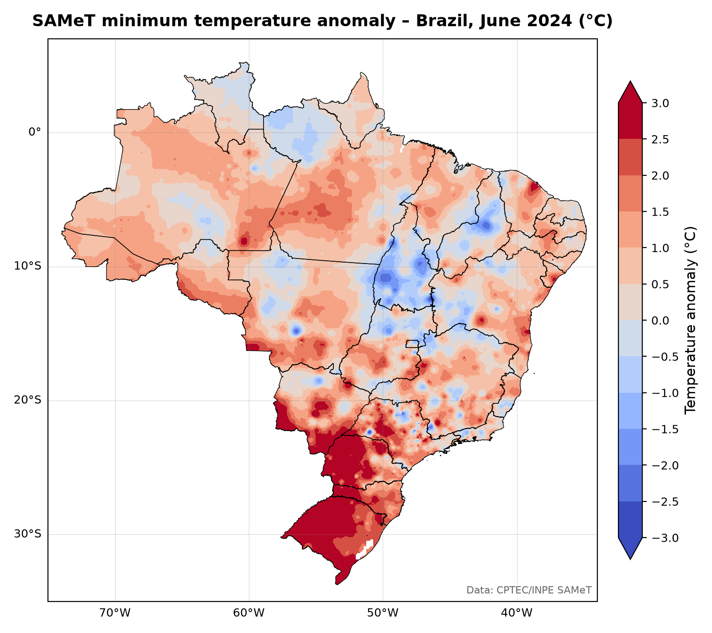
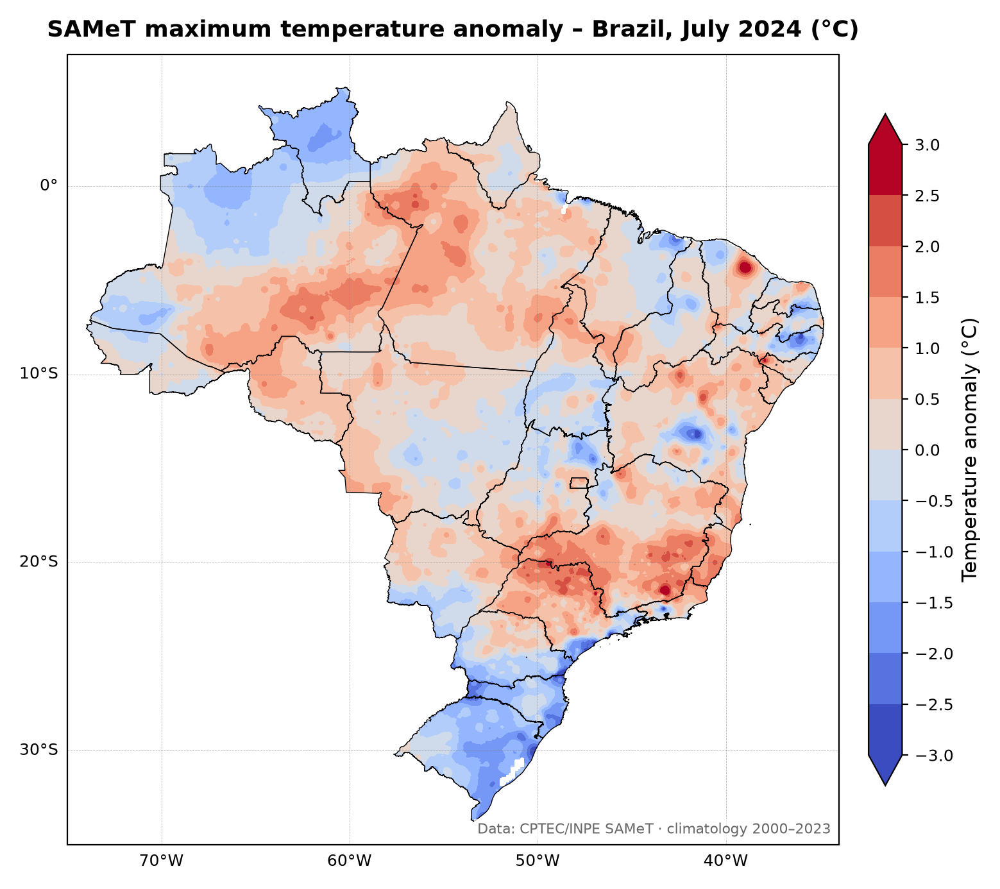
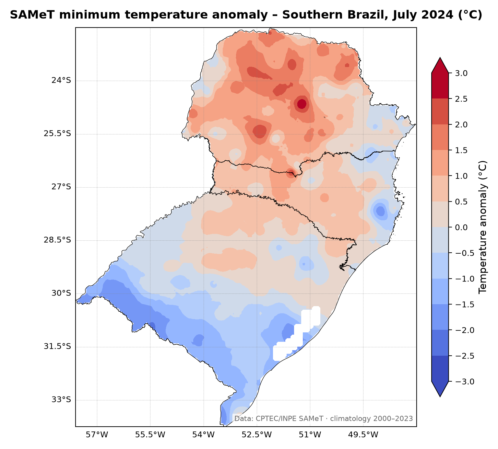

# SAMET-CPTEC

> **Project history.** This is the original README, kept for reference. Folder and file
> names have been updated to the current English layout; see the main [README](../README.md).

This repository contains scripts for visualising temperature data from INPE/CPTEC's SAMeT product. This product combines observed data with the ERA5 reanalysis, correcting the temperature field with an estimated lapse rate.

## Description

The SAMET-CPTEC project focuses on visualising temperature anomaly data using CPTEC/INPE's SAMeT product.

## Repository structure

- `scripts/`: scripts used to process and analyse the data.
- `data/`: raw and processed data.
- `figures/`: figures generated from the data.

## Prerequisites

Before running the scripts, you will need to install the following Python libraries:

- numpy
- geopandas
- matplotlib
- pygrib
- cartopy
- xarray
- netCDF4

## Images

### Figure 1: Example of a monthly minimum temperature anomaly



### Figure 2: Example of a monthly maximum temperature anomaly



### Figure 3: Example of a monthly minimum temperature anomaly - South



## How to use

1. Clone this repository:
    ```bash
    git clone https://github.com/valkiriaandrade/samet-temperature-anomaly-maps.git
    ```

2. Go to the project folder:
    ```bash
    cd samet-temperature-anomaly-maps
    ```

3. Run the scripts as needed.

## Contributing

Contributions are welcome! Feel free to open issues and pull requests.

## License

This project is licensed under the MIT License. See the [LICENSE](../LICENSE) file for details.
